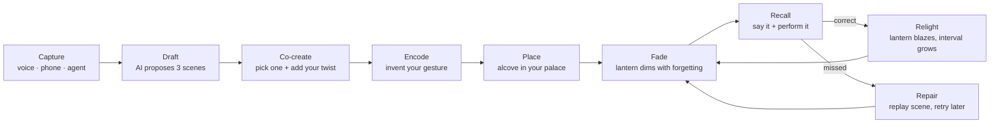
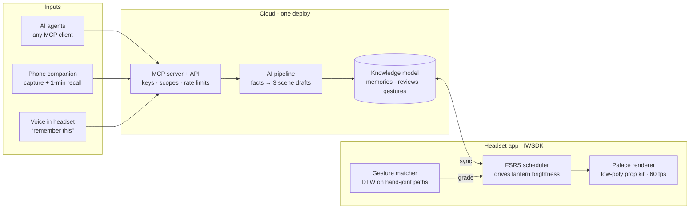

<div align="center">

# Atrium

### Your hands write it. Your palace keeps it. You never fall behind.

**A seated, hands-only memory palace for Meta VR Glasses and Meta Quest.**
You co-create every memory with an AI agent, write it with your own gesture, and watch it fade and come back as you review.

`Productivity track` · `New Experience division` · `Meta VR Start Developer Competition 2026`

[Run it](#getting-started-developers) · [Demo video](#demo) · [Architecture](#architecture) · [MCP server](#mcp-server-for-ai-agents) · [Research](#research-foundation)

</div>

> **Build status (Nov 2026):** the offline headset core is playable: the first five minutes, co-created scenes, gesture signatures, FSRS-driven lanterns, graded recall by voice + gesture, no-backlog daily sessions, comeback walk, ember streaks, gaze-only mode, captions. It runs in the Quest browser and on desktop.
> **Not built yet:** cloud API, sync, MCP server, AI scene drafting, phone companion. Sections describing them are the design, marked *(planned)*.

---

## Table of contents

- [Why Atrium](#why-atrium)
- [What makes it different](#what-makes-it-different)
- [Demo](#demo)
- [Try it (for judges)](#try-it-for-judges)
- [How it works](#how-it-works)
- [Controls](#controls)
- [Features in detail](#features-in-detail)
- [Architecture](#architecture)
- [Tech stack](#tech-stack)
- [Project structure](#project-structure)
- [Getting started (developers)](#getting-started-developers)
- [Environment variables](#environment-variables)
- [MCP server for AI agents](#mcp-server-for-ai-agents)
- [Data model](#data-model)
- [Algorithms](#algorithms)
- [Design rules for VR Glasses](#design-rules-for-vr-glasses)
- [Accessibility](#accessibility)
- [Performance budget](#performance-budget)
- [Privacy and security](#privacy-and-security)
- [Research foundation](#research-foundation)
- [Roadmap](#roadmap)
- [Competition submission](#competition-submission)
- [Contributing](#contributing)
- [License and credits](#license-and-credits)

---

## Why Atrium

The science of remembering is settled: spaced, effortful recall works. Yet most people who start a memory system quit. Four problems cause it:

| Problem | What happens |
| --- | --- |
| **The review pile** | Skip a few days of spaced repetition and hundreds of cards are waiting. This is the most common reason people quit. |
| **Making cards** | Writing good cards takes longer than the lecture they come from. |
| **AI cards don't stick** | When AI makes the cards, you lose the learning that making them gave you. |
| **Building palaces is tedious** | The memory palace works, but people tire of constructing new ones and run out of places. |

AI agents now find and summarise everything for us. That multiplies what we're expected to know without helping us remember any of it.

**Atrium is where your hands write memories and your agents learn what you know.**

---

## What makes it different

| | Atrium | Flashcard apps | Other VR memory palaces |
| --- | :---: | :---: | :---: |
| You co-create each mnemonic (AI drafts, you decide) | ✅ | ❌ | ❌ |
| A gesture you invent, graded against your own recording | ✅ | ❌ | ❌ |
| Memories visibly dim as you forget them | ✅ | ❌ | ❌ |
| Fixed-length sessions that never pile up | ✅ | ❌ | ❌ |
| AI agents can add memories **and** read what you know | ✅ | ❌ | ❌ |
| Controller-free, seated, built for a 70° field of view | ✅ | n/a | ❌ |

---

## Demo

> 📺 **Demo video (2:30):** `<YouTube or Vimeo link>`
>
> All footage is real headset or emulator capture.

| First five minutes | Daily session | Agent capture |
| --- | --- | --- |
| `docs/media/first-five.gif` | `docs/media/daily-session.gif` | `docs/media/agent-capture.gif` |

---

## Try it (for judges)

> *(Deployment pending: until then, run it locally; see [Getting started](#getting-started-developers).)*

Atrium runs in the Meta Quest browser. No install, no controllers and no account needed.

1. Put on a **Meta Quest 3 or 3S** and sit down.
2. Open the browser and go to **`<your-deployment-url>`**.
3. Press **Enter VR**, put the controllers down and raise your hands.
4. Follow the narrator. In about five minutes you'll learn six Japanese words and recall them.
5. *(planned)* **To try the agent:** on a phone or laptop, open **`<your-deployment-url>/companion`** and sign in with the demo key printed on the welcome screen. Type a topic (for example *"the 12 cranial nerves"*) and watch the items arrive in the headset inbox.

> **If hands aren't detected:** hold both hands in front of the headset for two seconds. If tracking still doesn't start, pinch once or restart the headset. This is a known Quest wake-from-sleep issue.

---

## How it works



**A memory is born in about 20 seconds:**

1. **Capture.** Say *"remember this…"* in the headset, scan a QR code to send text from your phone, or let an agent send it.
2. **Draft.** Atrium's agent extracts the facts and proposes **three vivid scenes** built from a pre-made 3D prop kit, each with a one-line mnemonic.
3. **Co-create.** Pinch the scene you like and add one personal detail by voice (*"make the cat wear my grandmother's glasses"*).
4. **Encode.** A ghost hand suggests a gesture that matches the meaning. You perform your own version twice, and Atrium records it as that memory's **gesture signature**.
5. **Place.** The scene settles into the next free alcove and its lantern lights at full brightness.

From then on the lantern dims along the memory's forgetting curve. A daily **7-minute session** relights the memories that are fading fastest and matter most for your goal.

---

## Controls

| Action | Hands | Gaze-only mode | Voice |
| --- | --- | --- | --- |
| Select | Look + pinch | Look + dwell 1 s | "Select" |
| Next arc of alcoves | Pinch + flick sideways | Dwell on edge arrow | *(planned)* |
| Answer a recall | Say the answer + perform your gesture | Say the answer | Say the answer |
| Reveal | Pinch "Show me" | Dwell "Show me" | |
| Pause | Leaving the headset view pauses; hands lost > 2 s pauses | | |

**Desktop:** the mouse points, click selects, arrow keys turn the room, Esc pauses, and gestures are mouse paths.
**No speech recogniser?** Recall switches to three pinchable answers, still graded and never self-rated.

No action ever needs a controller, standing up, or turning your body. *(Planned: pull-to-inspect, open-palm pause, voice commands.)*

---

## Features in detail

### 1. Co-created mnemonics
The AI does the slow part; you do the part that makes it stick. You get three scene options as structured JSON (props, positions, mnemonic). You pick one and speak a twist, which the agent maps onto props and colours from the kit. If you skip the twist three times in a row, Atrium asks one quick personal question instead.

### 2. Gesture signature
You invent a gesture that matches each memory's meaning (for *neko*, cat: stroking a cat). Atrium records the path of key hand joints and, at recall, compares your new gesture with **your own recording** using dynamic time warping. It never assigns gestures from a fixed list, because gestures that don't match the meaning can hurt recall.

### 3. The dimming palace
Each lantern's brightness **is** the memory's live recall probability from the FSRS model.

| Recall probability | Lantern |
| --- | --- |
| ≥ 90% | Full, steady glow |
| 82–90% | Dimming |
| 75–82% | Flickering |
| < 75% | Flickering, scene loses colour |

The bands sit just under the 90% retention target because the FSRS-6 forgetting curve is long-tailed: a memory left alone for three weeks is still at ~74%. Wider bands would almost never show. They are one constant in `src/core/lantern.ts`, to be tuned with real review data.

Relighting a flickering lantern with a correct recall plays a warm chime and a burst of light. That moment is the core reward.

### 4. No-backlog sessions
Each session has a fixed time budget (7 minutes by default). Atrium ranks due memories by how close they are to being forgotten, weighted by your goal and deadline, and fills only that budget. Overflow is spread across the coming days. After three or more missed days, a **Comeback walk** shows only the 10 most important fading memories, with no due count shown.

### 5. Readiness score *(planned)*
Set a goal with a date (*"JLPT N5 on 1 March"*). Atrium forecasts what share of that goal you'll recall on the day, and sets the daily load needed to hit your target.

### 6. Habit system

| Mechanic | Rule |
| --- | --- |
| **Ember streak** | The day counts after one 60-second recall, in the headset or on your phone |
| **Freezes** | Each full headset session earns one freeze (bank up to 3) |
| **Repair** | Restore a broken streak within 48 hours by completing a double session |
| **Weekly mode** | Optional: 5 of 7 days counts as a streak week |
| **Milestones** | 7 / 30 / 100 / 365 days unlock new wings and palace themes |
| **Wings** | New arcs of alcoves at 25 / 100 / 500 mastered memories |

**Guardrails:** no paid streak protection, no loot boxes, at most one notification a day, and a gentle stop after 20 minutes.

### 7. Phone companion *(planned)*
Capture from anywhere, and keep the streak alive with a 60-second **mental walk**: recall one wing of your palace from a top-down map, then check your answers.

### 8. Room mode *(planned, optional)*
Pin memories to real objects you can see from your chair (a lamp, a shelf, the window) using spatial anchors, so your real room can cue recall after the headset comes off. The virtual palace stays the default.

### 9. Wind-down mode *(planned, optional)*
A low-light walk through the day's new memories before bed.

---

## Architecture

*The headset half below is built. The cloud half is planned.*

One web project holds the headset app, the API, the MCP server and the companion page, deployed to a single URL.



- **Offline-first headset.** Due memories sync down and review results sync up. Grading and scheduling run on the device, so reviews keep working without a network.
- **The first five minutes need no network.** The preset deck ships with the build, so onboarding can never fail on a slow connection.
- **Background capture.** Imports are processed in the cloud while you use the palace, and arrive in your inbox.

---

## Tech stack

| Layer | Choice | Why |
| --- | --- | --- |
| Headset app | [three.js](https://threejs.org) + raw WebXR (TypeScript, Vite) | Hand joints, select-on-pinch and head gaze straight from WebXR; ships as a link; the same code targets VR Glasses. IWSDK (built on three.js) is an option later; direct WebXR keeps the input layer fully under our control. |
| Scheduler | [ts-fsrs](https://github.com/open-spaced-repetition/ts-fsrs) | FSRS-6 in TypeScript, runs on the device |
| Gesture matching | Custom recogniser (DTW) | Grades your gesture against your own recording |
| Speech | Web Speech API (recognition in `ja-JP`, narration via speech synthesis) | Spoken answers and twists; pinchable fallback when missing |
| Audio | Web Audio, synthesised | No audio files to download |
| 3D assets | Procedural low-poly prop kit (three.js primitives) | Zero downloads, so the first five minutes work offline. Swap in a CC0 glTF kit later; the scene JSON doesn't change. |
| AI pipeline *(planned)* | Any LLM with structured JSON output | Providers can be swapped |
| Hosting *(planned)* | Vercel (static app + API routes + MCP endpoint) | One deploy, one URL |
| Database *(planned)* | Postgres (e.g. Neon) | Memories, review logs, gesture signatures |
| MCP *(planned)* | MCP TypeScript SDK over remote HTTP | Any MCP client can connect |

---

## Project structure

```
atrium/
├── index.html                  # landing overlay: Enter VR / Try on desktop
├── src/
│   ├── main.ts                 # renderer, XR session, loop, home screen, settings
│   ├── core/                   # pure logic, no DOM; all unit-tested
│   │   ├── gesture.ts          # resample, centre, DTW, enrol, match
│   │   ├── model.ts            # FSRS replay from the review log, recall probability
│   │   ├── grade.ts            # answer + gesture + latency → again/hard/good
│   │   ├── triage.ts           # no-backlog session planning, comeback walk
│   │   ├── streak.ts           # ember streak, freezes, 48 h repair
│   │   ├── lantern.ts          # recall probability → brightness, flicker, saturation
│   │   ├── answer.ts           # kanji / kana / romaji answer matching
│   │   └── twist.ts            # spoken twist → prop kit changes (offline)
│   ├── headset/
│   │   ├── palace.ts           # room, 20 alcoves, lanterns, snap-and-fade turning
│   │   ├── input.ts            # gaze + pinch, flick, dwell, hand-joint gesture features
│   │   ├── stage.ts            # captions, buttons, scene cards, pause: awaitable steps
│   │   ├── flows.ts            # first five minutes, graded recall, daily session
│   │   ├── scene-builder.ts    # scene JSON → 3D group, desaturation
│   │   ├── store.ts            # offline store (review log is the source of truth)
│   │   ├── speech.ts           # recognition + narration, with fallbacks
│   │   ├── audio.ts            # synthesised chimes
│   │   └── ui.ts               # canvas-text panels and buttons
│   └── shared/
│       ├── types.ts            # Memory, Review, SceneSpec, GestureSignature
│       ├── props.ts            # procedural prop kit
│       └── deck-ja.ts          # preset 6-word Japanese deck (ships offline)
└── tests/core.test.ts          # gesture, grading, FSRS, triage, streak, answers, deck schema
```

Planned: `api/` (memories, sync, goals, MCP), `api/pipeline/` (extract, draft scenes), `db/schema.sql`, `src/companion/`.

---

## Getting started (developers)

### Prerequisites

- **Node.js 20.19+**
- A **Meta Quest 3 / 3S** for device testing. Desktop mode is fine for day-to-day work, but performance, hand tracking and speech must be checked on hardware.

### Install and run

```bash
git clone https://github.com/<your-org>/atrium.git
cd atrium
npm install

npm run dev                   # Vite dev server on your LAN
```

Open the printed URL and press **Try on desktop**. Useful URL flags:

| Flag | Effect |
| --- | --- |
| `?reset` | Erase local data and start the first five minutes again |
| `?skip=3d` / `?skip=12h` | Run the clock ahead to see lanterns fade, the daily session and the comeback walk (`?skip=0d` restores real time) |
| `?gaze=1` | Gaze-only mode (dwell 1 s to select) |

### Test on a Quest headset

The Quest browser needs **HTTPS** to enter VR. Either:

- deploy a preview build (`npm run deploy:preview`) and open its URL in the headset, or
- tunnel your local server over HTTPS and open the tunnel URL in the Quest browser.

### Useful scripts

| Script | What it does |
| --- | --- |
| `npm run dev` | Local dev server with hot reload |
| `npm run build` | Type-check + production build |
| `npm run preview` | Serve the production build |
| `npm run test` | Unit tests (gesture matcher, grading, FSRS, triage, streak, answers, deck schema) |
| `npm run lint` | Type-check |

---

## Environment variables

None needed for the headset core. Planned for the cloud half:

| Variable | Required | Description |
| --- | :---: | --- |
| `DATABASE_URL` | ✅ | Postgres connection string |
| `LLM_API_KEY` | ✅ | Key for the scene-drafting model |
| `LLM_MODEL` | ✅ | Model identifier used by the pipeline |
| `SESSION_SECRET` | ✅ | Secret for signing sessions and API keys |
| `ATRIUM_DEMO_API_KEY` | ✅ | Key for the pre-connected judge demo account |
| `STT_API_KEY` | ⬜ | Cloud speech-to-text fallback, if Web Speech isn't available |
| `PUBLIC_BASE_URL` | ⬜ | Base URL for QR pairing links |

---

## MCP server for AI agents *(planned)*

Atrium exposes a remote **Model Context Protocol** server, so any MCP-compatible agent can **write** things you need to remember and **read** what you already know.

### Connect a client

```json
{
  "mcpServers": {
    "atrium": {
      "url": "https://<your-deployment-url>/api/mcp",
      "headers": { "Authorization": "Bearer <your-atrium-api-key>" }
    }
  }
}
```

Generate a key in the companion page under **Settings → Connected agents**. Each key has its own scopes and can be revoked at any time.

### Tools

| Tool | Scope | Description |
| --- | --- | --- |
| `add_memories` | write | Send text or facts, with an optional topic and goal. Items wait in your inbox until you co-create them. |
| `create_goal` | write | Create a goal with a deadline; it gets its own wing. |
| `list_due` | read | What's fading today and how long the session will take. |
| `get_known` | read | Facts in a topic you reliably recall (> 90% predicted). |
| `get_gaps` | read | Facts in a goal you're most likely to forget, ranked. |
| `get_readiness` | read | Forecast recall for a goal on its deadline. |

### Example

```text
You → agent:  "Add the 12 cranial nerves to my Atrium for my anatomy exam."
Agent → add_memories({ topic: "Cranial nerves", goal: "Anatomy block", items: [...] })
Atrium → 12 items appear in your headset inbox, ready to co-create.
```

> **Safety by design:** imported items never enter the palace until you co-create them, so an agent can't fill your memory with things you didn't choose.

---

## Data model

Built today: the same shapes in `src/shared/types.ts`, stored locally. FSRS state isn't stored; it is replayed from the append-only review log, so syncing will just merge new reviews. Planned Postgres schema:

```sql
-- simplified
memories (
  id            uuid primary key,
  user_id       uuid,
  fact          text,          -- what to remember
  answer        text,          -- what recall is checked against
  mnemonic      text,          -- one-line hook
  scene         jsonb,         -- chosen props, positions, colours
  twist         text,          -- the user's personal detail
  gesture       jsonb,         -- recorded joint paths (2 enrolments)
  topic         text,
  goal_id       uuid,
  created_at    timestamptz
)

reviews (
  id            uuid primary key,
  memory_id     uuid,
  reviewed_at   timestamptz,
  result        text,          -- again | hard | good | easy (derived)
  answer_ok     boolean,       -- spoken answer matched
  gesture_score real,          -- DTW similarity, 0–1
  latency_ms    integer
)

goals (id uuid, user_id uuid, name text, deadline date, target real)
agents (id uuid, user_id uuid, name text, scopes text[], key_hash text, revoked boolean)
```

---

## Algorithms

### Gesture matching

1. **Capture:** every frame for 2 s (3 s at recall). Per hand: the **wrist's path** in the head's yaw frame (÷ 15 cm), plus five **finger curls** (fingertip-to-wrist ÷ hand size, down-weighted). Keeping the wrist path matters because iconic gestures (stroking a cat) are mostly wrist movement. On desktop, the mouse path.
2. **Normalise:** resample to 32 frames; centre the position dimensions on the gesture's own mean, so where you start doesn't matter, only the shape.
3. **Enrol:** record twice. The DTW distance between the takes sets your tolerance, with a floor so two near-identical takes don't make the gesture impossible to repeat. If you barely moved, or the takes differ a lot, Atrium asks again.
4. **Match:** banded **dynamic time warping** to the nearer take; accept within tolerance × 2.2 (lenient on purpose).
5. **Grade:** the spoken answer decides pass or fail. Correct + gesture matched → *good*. Correct but gesture missed or slow (> 8 s) → *hard*. Wrong or "Show me" → *again*. A correct answer never grades below *hard*, because *again* resets FSRS stability.

### Session triage

```text
due              = recall_probability < 0.9  or  FSRS due time passed (short learning steps)
priority(memory) = (1 − recall_probability) × goal_weight × deadline_urgency
session          = top items by priority until the time budget (7 min ≈ 21 recalls) is filled
overflow         = simply waits; it is ranked again tomorrow, and no pile is ever shown
comeback walk    = after ≥ 3 days with no reviews: top 10 by priority, no due count shown
repair           = a missed item is asked again two items later, once
```

### Lantern brightness

Brightness follows the live recall probability on the FSRS-6 forgetting curve, computed in fractional days so lanterns fade smoothly rather than in daily steps. It is squared so early fading is visible. Lanterns flicker below 0.82 and the scene desaturates below 0.75. The scale uses **brightness, not hue**, so it's safe for colour-blind users.

---

## Design rules for VR Glasses

- **Controller-free from launch to exit.**
- **Seated, two-foot radius:** nothing needs reaching beyond a forearm's length or turning the torso.
- **Central 35°:** all text, active lanterns and buttons sit in the middle of the view, to fit the ~70° field of view of Meta VR Glasses.
- **No palm-up gestures near the face:** that pose opens the Quest system menu.
- **Hands-lost recovery:** if tracking drops for more than 2 s, pause and show *"Show your hands"*; resume when they're back.
- **Comfort:** snap movement with a 150 ms fade, no smooth camera motion, a fixed horizon, a floor under the chair.
- **Fast in, fast out:** cold start to first pinch in under 10 s; pause and resume keep your exact place.

---

## Accessibility

- **Gaze-only mode:** dwell to select; no gestures needed ✅
- **Captions** on all narration ✅
- **Larger text** ✅
- **Colour-blind-safe** lanterns (brightness, not hue) ✅
- **No-speech fallback:** pinchable answers ✅
- *(planned)* Voice-only mode, explicit one-handed mode, high-contrast theme

---

## Performance budget

| Metric | Target (Quest 3) |
| --- | --- |
| Frame rate | Steady 72 fps (≤ 13.9 ms per frame); Quest 3's lowest refresh rate is 72 Hz, requested via `updateTargetFrameRate` |
| Visible scenes | ≤ 12 alcoves at once |
| Lighting | 1 hemisphere light, no shadows; lanterns are emissive + additive sprites |
| Cold start to first pinch | < 10 s |
| Scene creation after choosing | Instant (assembled from the prop kit, no mesh generation) |
| First five minutes | Fully offline |

---

## Privacy and security

What you know is personal data, and Atrium treats it that way.

- **Per-agent keys and scopes** (write-only, one goal, or everything), revocable from the headset or phone.
- **Nothing enters your palace without you:** every import waits in the inbox until you co-create it.
- **Rate limits** on all write tools.
- **Gesture recordings** are stored only as normalised joint paths, never as video.
- **Export and delete:** download all your data or delete your account at any time.

---

## Research foundation

Every core feature rests on published work. These are the studies' own results, not Atrium's. Atrium's effect is unmeasured until tested with users.

| Finding | Source | Shapes |
| --- | --- | --- |
| A memory palace in a headset gave **8.8% better recall** than the same palace on a monitor | Krokos, Plaisant & Varshney, *Virtual Reality* (2019) | The palace |
| Gestures help word memory **only when they match the meaning**; mismatched or meaningless gestures did worse than none | *Applied Psycholinguistics*, gestures and L2 learning | Invented iconic gestures |
| Writing your own mnemonic story for Chinese characters scored **18.8 percentage points higher** on written recall immediately (descriptive pilot, n = 8), but took 1.69× as long to study | [arXiv 2611.01973](https://www.alphaxiv.org/abs/2611.01973) | Co-creation (keep it quick) |
| Unrestricted AI help raised task scores but **not knowledge gained** | [arXiv 2412.09315](https://www.alphaxiv.org/abs/2412.09315) | AI drafts, you decide |
| Flip-and-self-rate is an impoverished review; effortful recall works better | [Memdora, arXiv 2607.25096](https://www.alphaxiv.org/abs/2607.25096) | Graded recall |
| Personalised mnemonics as AI-generated 3D models in AR (slow to generate; timings in the paper) | [VocabulARy 2.0, arXiv 2611.07798](https://www.alphaxiv.org/abs/2611.07798) | Prop-kit scenes instead of mesh generation |
| Adjusting a VR memory palace's spatial layout to a person's cognitive load raised EEG focus markers (n = 10) | [arXiv 2506.02700](https://www.alphaxiv.org/abs/2506.02700) | Calm, simple alcoves |
| Auto-generated keyword cues support vocabulary learning | [arXiv 2305.10436](https://www.alphaxiv.org/abs/2305.10436), [arXiv 2501.17099](https://www.alphaxiv.org/abs/2501.17099) | Scene drafts |

---

## Roadmap

- [x] Concept, research and design
- [x] **Headset core:** palace, first five minutes, co-creation (offline twist), gesture signature, dimming lanterns, graded recall, no-backlog sessions, comeback walk, streaks with freezes and repair, gaze-only mode, captions
- [ ] Device pass on Quest 3: frame timing, hand-tracking thresholds, Quest-browser speech recognition
- [ ] Cloud: API, sync, AI scene drafting, voice/QR capture, `add_memories`
- [ ] Readiness score and goals
- [ ] `get_known` / `get_gaps` read tools
- [ ] Phone companion with mental walk
- [ ] Room mode (spatial anchors)
- [ ] Wind-down mode
- [ ] Creator palaces and revenue share
- [ ] Launch alongside **Meta VR Glasses (spring 2027)**

---

## Competition submission

| | |
| --- | --- |
| **Competition** | Meta VR Start Developer Competition 2026 |
| **Track** | Productivity |
| **Division** | New Experience (built within the competition window) |
| **Platform** | Meta Quest 3 / 3S (Quest browser); designed for Meta VR Glasses |
| **Input** | Hands-first; fully usable without controllers |
| **Play mode** | Seated |
| **Target launch** | Spring 2027 |

---

## Contributing

Issues and pull requests are welcome after the judging period ends. Until then the `main` branch is frozen to match the submitted build.

1. Fork the repo and create a branch: `git checkout -b feature/your-idea`
2. Run `npm run lint && npm run test` before you push
3. Open a pull request describing what changed and how you tested it on a headset

---

## License and credits

- **Code:** MIT *(LICENSE file to be added)*.
- **3D props:** procedural, made in code; no third-party assets.
- **Scheduling:** the open-source FSRS algorithm via `ts-fsrs`.

### Team

| Name | Role | Contact |
| --- | --- | --- |
| `<name>` | `<role>` | `<email>` |

<div align="center">

**AI made information infinite. Atrium makes it yours.**

</div>
