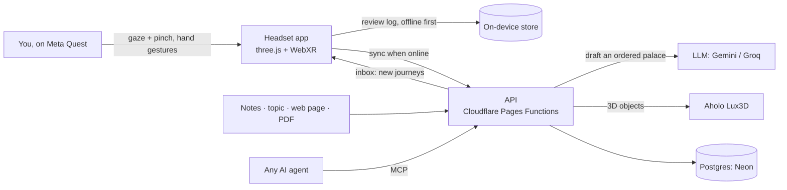

<p align="center"></p>

<p align="center">
  <a href="https://atrium-b0r.pages.dev"><b>Open it on Quest</b></a> ·
  <a href="#4-atrium-in-four-moments"><b>How it works</b></a> ·
  <a href="#2-the-research"><b>Research</b></a> ·
  <a href="#6-why-meta-quest"><b>Why Meta Quest</b></a> ·
  <a href="#7-architecture"><b>Architecture</b></a> ·
  <a href="#11-run-it"><b>Run it</b></a> ·
  <a href="docs/SUBMISSION.md"><b>Submission</b></a> ·
  <a href="docs/META_INTEGRATION.md"><b>Meta integration</b></a>
</p>

<p align="center">
  
  
  
  
  
</p>

**Atrium** turns what you need to remember into a memory palace you sit inside and walk through with your hands.
Paste your notes, a chapter, a web page or a PDF, or just say a topic like *"the 12 cranial nerves"*. Atrium builds an
ordered journey with one vivid 3D scene on every pedestal. You walk it in once, then the lights go down and you walk it
from memory, forwards, backwards or straight to *number 7*, answering with a pinch. Lanterns dim along your own
forgetting curve and relight in gold when you remember.

<p align="center">
  <a href="https://atrium-b0r.pages.dev"></a><br>
  <sub>Every product shot here is <b>the real Atrium</b>, running in a WebXR session on Meta's Immersive Web Emulator as a Meta Quest 3.</sub>
</p>

<table><tr>
<td width="150" align="center"></td>
<td>

**Hi, I'm Lumen,** the lantern spirit who lives in your palace. I walk you through your first five minutes, I react to
every answer, and I reword the questions you keep missing. The short version of this page: **we forget most of what we
learn within a day, flashcards lose the order of things, and the oldest memory technique there is needs a place to
walk through. Meta Quest can build that place for you.**

</td></tr></table>

---

## 1. The problem

<table><tr>
<td width="55%" valign="top">

**You read it. You highlighted it. You made the flashcards. Two days later, it's gone.**

- **Cramming fades fast.** Most of what we learn is forgotten within a day unless we review it.
- **Flashcards lose the order.** A list of nerves, the steps of a process, the points of a talk: a deck of cards
  can't hold *what comes next*.
- **Making cards is slow, and missed days pile up.** Skip a few days and the review queue becomes a wall.
- **Rereading feels like learning, but isn't.** Testing yourself works far better, yet most study tools make it
  a chore.

**The missing piece is a place to put things, in order, that you can walk back through.**

</td>
<td width="45%"></td>
</tr></table>

## 2. The research

Atrium is built on four well-established findings. Follow the links.

<table><tr>
<td width="45%"></td>
<td width="55%" valign="top">

| | Finding | Source |
|---|---|---|
| **The forgetting curve** | Memory decays steeply in the first hours and days after learning | Ebbinghaus, *Über das Gedächtnis*, 1885 |
| **Testing beats rereading** | Retrieval practice leads to far better retention after a week than restudying | Roediger & Karpicke, [Psychological Science 2006](https://doi.org/10.1111/j.1467-9280.2006.01693.x) |
| **40 days** | Of method-of-loci training more than doubled word recall in people new to it | Dresler et al., [Neuron 2017](https://doi.org/10.1016/j.neuron.2017.02.003) |
| **8.8%** | Better recall from a memory palace in a headset than the same palace on a monitor | Krokos, Plaisant & Varshney, [Virtual Reality 2019](https://doi.org/10.1007/s10055-018-0346-3) |

</td></tr></table>

<table><tr>
<td width="150" align="center"></td>
<td>

**Lumen, reading the papers:** "Here's what the research told us to build. **Recall, not review**: every session is
you remembering, never flipping a card (Roediger & Karpicke). **A schedule from your own forgetting curve**, so I
show you a memory right before it fades (Ebbinghaus, via FSRS). **A route, in order**, because that's how memory
champions do it (Dresler). **And put it in a headset**, because immersion helps (Krokos)."

</td></tr></table>

## 3. What Atrium does

| | Feature | How |
|---|---|---|
| 🏛️ | **One sentence becomes a palace** | Paste notes, a topic, a web page or a PDF. An ordered journey is drafted: one pedestal per item, a vivid 3D scene each, every scene leading to the next. When a topic names its count, every item is there. |
| 🚶 | **Walk it in, walk it from memory** | Place each stop once. Then the lights go down: recall forwards, backwards, or jump straight to any number. |
| 🤏 | **Hands only** | Look at something and pinch to select. Flick your hand sideways to turn the ring. No controllers, seated, comfortable. |
| ✋ | **Your gesture is the key** | Trace a gesture that matches a memory's meaning; Atrium recognises your own hand path (dynamic time warping). |
| 🏮 | **Lanterns that follow your memory** | Each lantern's brightness follows that memory's predicted recall (FSRS). Fading lanterns flicker; recalling one relights it in gold. |
| 🔥 | **You never fall behind** | Daily sessions have a fixed time budget; missed days never pile up. Streaks with freezes and a 48-hour repair. |
| 🎮 | **Play and compete** | Recall Rush (a 90-second memory game), a daily challenge, duels, friends, leagues, and a 40-day Memory Athlete programme. |
| 🌸 | **Three worlds, five languages** | A forest garden, a moonlit shrine lake, sakura valleys. English, 中文, हिन्दी, Español, 日本語. |
| 🤖 | **Agents can feed it** | An MCP server lets any AI agent build palaces, add memories or ask what you already know. |

<p align="center">


<br><sub>Build · Recall · Done. Atrium in a WebXR session on Meta's Immersive Web Emulator (Meta Quest 3).</sub>
</p>

## 4. Atrium in four moments

<table>
<tr>
<td width="50%" valign="top">

**① Name what you need to remember.** Say or type a topic, or paste a chapter. Atrium builds the palace: the 12
cranial nerves become 12 pedestals, in order.


</td>
<td width="50%" valign="top">

**② Walk it in.** One stop at a time, a vivid scene appears on each pedestal, and a short story links it to the next.


</td>
</tr>
<tr>
<td valign="top">

**③ Walk it from memory.** *"Next stop, number 4?"* Pinch the answer. The lantern relights, and Lumen cheers.


</td>
<td valign="top">

**④ Come back tomorrow.** Your lanterns dim as memories fade; a few minutes a day relights them. Three worlds unlock
as your streak grows.


</td>
</tr>
</table>

<table><tr>
<td width="150" align="center"></td>
<td>

**Lumen, on comfort:** "People ask me: *won't VR make me tired?* Here's what we did about it."

</td></tr></table>

| Concern | What Atrium does |
|---|---|
| Motion sickness | You're seated and the camera never moves you. Turning is a 150 ms fade-snap, not a smooth rotation. |
| Tired arms | Everything active sits within ±17.5° of your gaze; answers are a small pinch, not a reach. |
| Losing hand tracking | Atrium pauses gently and waits for your hands. |
| Can't pinch | Gaze-only mode: hold your gaze for one second to select. |
| A slow headset | A frame guard watches frame times and hides distant scenes, then swaps 3D models for paintings, to hold frame rate. |
| No network | Offline-first: the review log lives on the headset; the first session works with no account. |

## 5. Five languages, three worlds

<table><tr>
<td width="50%"></td>
<td width="50%" valign="top">

The whole first session, the menus, the worlds and Lumen's narration work in **English, 中文, हिन्दी, Español and
日本語**, and the website follows the same choice. Lumen speaks each language with a matching voice.

On day one you choose your world: **Garden** (a sunlit forest), **Moonlit** (a shrine lake with 3D sakura pagoda
lanterns) or **Sakura** (blossom valleys). The other two open after 7 days of ember; *Golden hour* at 365. The
whole room changes with the world: stone, floor, banners, lanterns, the menus, even Lumen's cloak.

</td></tr></table>

## 6. Why Meta Quest

<p align="center"></p>

- **Hand tracking makes it natural.** A memory palace is about places and movement; pinching an answer and tracing a
  gesture feels like remembering, not operating an app.
- **WebXR in the Quest Browser.** No install, no store review: open the link and you're inside. The same build runs
  on a computer with a mouse.
- **Seated and standalone.** Designed for a chair, a desk and a few minutes a day, with a frame guard to keep Quest
  at frame rate.
- **Built and tested with Meta's tools.** Every flow is driven end to end on Meta's **Immersive Web Emulation
  Runtime** (IWER) as a Meta Quest 3, with scripted head gaze and hand pinches (`film/capture/take.mjs`).
- **Passthrough next.** A "room mode" (WebXR immersive-ar) puts your palace in your own room; it's built, and the next
  step is testing it on a headset.

## 7. Architecture



- **Offline first.** The review log is the source of truth; FSRS state is replayed from it, so the headset works without
  a network and sync never double-counts.
- **Journeys.** Ordered stops, a landmark every fifth stop, recall by direction or position (`src/core/journey.ts`).
- **Scheduling and lanterns.** FSRS replayed from the log; lantern brightness from recall probability
  (`src/core/model.ts`, `src/core/lantern.ts`, `src/core/triage.ts`).
- **Gesture signature.** Dynamic time warping on wrist paths and finger curl, with a tolerance learned from your own two
  recordings (`src/core/gesture.ts`).
- **Hands and gaze.** WebXR hand joints, pinch as select, flick to turn, hands-lost pause (`src/headset/input.ts`).
- **3D.** Every prop and Lumen were generated with Aholo Lux3D from our own paintings, simplified to about 10k
  triangles, compressed with meshopt, and fall back to the painting.
- **Agents.** An MCP server (`server/mcp.ts`) with tools to build palaces, add memories, set goals and read what you know.

## 8. What we verified

| Check | Result |
|---|---|
| Automated tests | **107 passing**, run by CI on every push: core logic, scheduling, journeys, gestures, sync, the API, MCP, the palace builder, and **12 that drive hands-only input through a simulated WebXR session** (`tests/hands.test.ts`) |
| A counted list stays complete | "The 12 cranial nerves" builds **12 stops**, even when the model returns fewer (tested with 9-, 10- and 11-stop drafts) |
| End to end on an emulated Meta Quest 3 | Build the 12 cranial nerves, walk them in, recall **12 of 12** by pinch, switch worlds and languages |
| Live deployment | Production health: database, AI, speech and 3D all on; build, recall, challenge, duels and leagues exercised |

Full status, feature by feature: [docs/STATUS.md](docs/STATUS.md). How each Meta requirement maps to code: [docs/META_INTEGRATION.md](docs/META_INTEGRATION.md). **Verify it yourself in two minutes:** open https://atrium-b0r.pages.dev, click through the first five minutes, then `npm ci && npm test`.

## 9. Roadmap

- **A full pass on Meta Quest hardware**: hand tracking, frame rate with the 3D models, speech, and room mode.
- **Room mode (passthrough)**: your palace in your own room.
- **Study rooms**: walk a palace with friends, live.
- **Teams and shared palaces** for classes.
- **Number and card systems** for the Memory Athlete programme.
- **Launch on the Meta Horizon Store.**

<table><tr>
<td width="150" align="center"></td>
<td>

**Lumen, being honest:** "Read this before you quote us. We'd rather you hear the limits from us."

</td></tr></table>

## 10. Honest limitations

- **Not yet run on a physical Quest.** Everything was tested on desktop and on Meta's emulated Quest 3; hand tracking,
  frame rate and speech on real hardware are next.
- **Room mode is untested.** It's built and only offered where passthrough is supported.
- **Speech has not been tried with real spoken audio** in the headset; pinchable answers are always offered.
- **The AI tier is free-tier.** Several palace builds in the same minute can hit the provider's rate limit; Atrium
  says "busy, try again" instead of building a broken palace.
- **The learning effect of Atrium itself is unmeasured.** We cite studies of the method; we haven't run our own yet.

## 11. Run it

```bash
git clone https://github.com/Aaditya1273/engram.git && cd engram
npm install
cp .env.example .env.local    # optional: an AI key (Gemini / Groq / NVIDIA), AHOLO_API_KEY for 3D, DATABASE_URL for Neon
npm run dev                   # headset app + companion + API + MCP on one dev server
```

Open it on a computer (mouse, arrow keys) or, for a Quest, run `npm run dev -- --host`, tunnel it over HTTPS and open
the tunnel in the Quest Browser. Without any keys, the first session and journeys work fully offline.

| Command | What it does |
|---|---|
| `npm run dev` | Local dev server with hot reload |
| `npm run build` | Type-check and production build |
| `npm run test` | Unit and integration tests (107) |
| `scripts/secrets.sh` | Copy keys to Cloudflare Pages secrets |

## Credits

- **3D models and Lumen:** generated with Aholo Lux3D from our own paintings.
- **Music in the film:** composed for Atrium in code (`film/music/compose_atrium.py`).
- **Fonts:** Fraunces and Source Sans 3 (SIL OFL).
- **Meta and Meta Quest** are trademarks of Meta Platforms, Inc.; the logo is shown to say what Atrium is built for.
- **AI tools:** Claude Code (Anthropic) wrote much of the code, tests, docs and film under the team's direction and
  review.

## Team Lusio Labs

- **Aaditya**, founder · builder and developer · [@Aaditya1273](https://github.com/Aaditya1273)
- **Aript**, idea and concept · testing · video

<table><tr>
<td width="150" align="center"></td>
<td>

**Lumen, signing off:** "Walk through it. Never forget it. Start with five minutes."

</td></tr></table>
