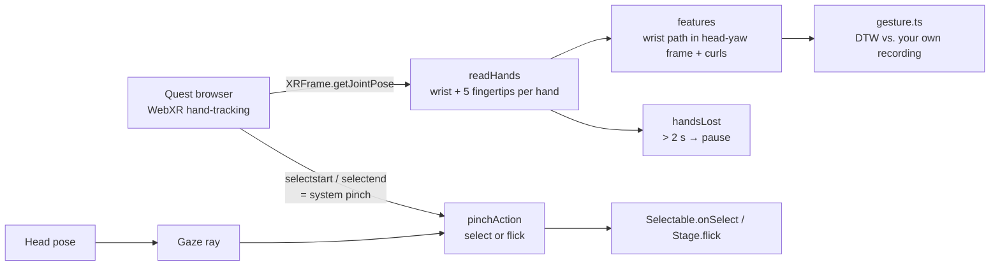

# Meta VR platform integration

This document maps each Meta VR Start Developer Competition 2026 requirement to the code that meets it and the test that checks it. Line numbers are as of this commit. "Not verified on device" means exactly that: the code path exists and is tested in simulation, but nobody has yet run it on a physical Meta Quest (see [STATUS.md](STATUS.md)).

## 1. Hard requirement: hands-first, end to end

The test is: *can someone complete the entire experience without ever pairing a controller?* Atrium never creates, requires or reads a controller.

### How hand input reaches the app



| Step | Code | Test |
| --- | --- | --- |
| Session asks for hand tracking (VR and passthrough "room" mode) | `src/main.ts:599`, `src/main.ts:613`: `requestSession(..., { optionalFeatures: ['local-floor', 'hand-tracking'] })` | n/a (browser API) |
| Hand joints read every frame: wrist, middle proximal (hand size) and five fingertips, lightly smoothed | `src/headset/input.ts:184` `readHands()` | `tests/hands.test.ts` › *reports hands as the input modality…* |
| **Look + pinch = select.** The system pinch arrives as WebXR `select`; the target is whatever head gaze hits | `src/headset/input.ts:77-87`, `src/core/hands.ts` `pinchAction()` | *look + pinch selects what the head is looking at* |
| **Pinch + sideways flick = next arc of alcoves**, judged against the head's right vector so it works facing any direction | `src/core/hands.ts` `pinchAction()` (7 cm, < 800 ms) | *pinch + sideways flick turns…*, *judges flicks relative to the head…* |
| **Your own gesture is the memory cue.** 2 s of two-hand features (wrist path in the head-yaw frame ÷ 15 cm, plus 5 finger curls per hand = 16 dims), graded with DTW against your own two enrolment takes | `src/headset/input.ts:233` `captureGesture()`, `src/core/hands.ts` `wristInYawFrame()` / `fingerCurls()`, `src/core/gesture.ts` | *records two-hand joint paths and grades a recall against your own recording*: enrols a "stroke the cat" gesture, accepts it repeated faster while turned 60° in the seat, rejects a wave |
| **Hands lost > 2 s pauses** with "Show your hands", and resumes when they're back | `src/headset/input.ts:173`, `src/main.ts:83-86` | *pauses when hands leave tracking…* |
| **No controller, no speech, no problem:** gaze-only mode (1 s dwell) and three pinchable answers when there's no speech recogniser or microphone | `src/headset/input.ts` dwell, `src/main.ts:508-515` | *gaze-only mode selects by a 1 s dwell, with no hands at all* |

The hands tests drive the **real `Input` class** through a simulated WebXR session: joint poses come from a fake `XRFrame.getJointPose` and pinches are dispatched as `selectstart`/`selectend` events, the same shape the Quest browser delivers. The session's input sources are hands only. Mutating the flick or yaw math makes these tests fail, which we checked.

## 2. Design guidelines

| Guideline | How Atrium meets it | Where |
| --- | --- | --- |
| **Seated, two-foot radius** (airplane seat test) | Alcoves come to you in arcs that you flick through; nothing needs standing, walking or turning your body. Flicks and gestures are measured in the head's frame, so you can sit facing any way. | `src/headset/stage.ts:95` `flick()`; `src/core/hands.ts`; layout in `src/headset/layout.ts` |
| **Fast cold start** | A web link with no install, account or download step. The first five minutes (learn and recall six words) need no network beyond the static site. | `index.html`; `src/shared/deck-ja.ts` |
| **Clean pause/resume** | Pauses on headset removal (`XRSession` `visibilitychange`), hands lost and Esc; resume returns to the same stop. | `src/main.ts:83-99`, `src/headset/stage.ts` pause layer |
| **A complete moment in 10 minutes** (one bus stop test) | Fixed-length sessions that never pile up, a comeback walk after missed days, and a hard stop at 20 minutes. | `src/core/triage.ts:38` `planSession()`; tests `session triage` |
| **Original, not a wrapper** (take it away test) | The palace, journeys, FSRS lanterns, DTW gestures, streaks and Recall Rush all run on-device. LLMs only draft scenes and import text; with no AI the offline drafter and built-in decks still work. | `src/core/*`; tests `offline drafter` and `World Builder` in `tests/server.test.ts` |
| **Comfort and performance** | Asks for 72 Hz on Quest 3; a frame guard steps quality down after 3 s of frames over a 15 ms budget (hide distant scenes, then swap 3D models for paintings). | `src/main.ts:96`, `src/core/frame-guard.ts:10`; tests `frame guard` |
| **70° field of view (VR Glasses)** | Text and panels sized for a narrow FOV; captions and larger text settings. | `src/headset/ui.ts`, README › *Design rules for VR Glasses* |

## 3. Platform features used

| Feature | Use |
| --- | --- |
| WebXR `immersive-vr` + `hand-tracking` | Main experience |
| WebXR `immersive-ar` (passthrough) | "Room mode": the palace architecture hides and memories sit in your real room (`src/main.ts:604-625`) |
| `XRSession.updateTargetFrameRate` | 72 Hz target (`src/main.ts:96`) |
| `XRSession` `visibilitychange` | Auto-pause when the headset comes off or the system UI opens |
| Microphone (`getUserMedia` + `MediaRecorder`) | Spoken answers transcribed server-side when the Quest browser has no speech recogniser (`src/headset/speech.ts`) |
| glTF 3D models | 26 props, finishes, the Lumen coach and the hinged recall chests (`public/art/models/`) |

**SDK choice:** three.js with raw WebXR rather than IWSDK. Owning the input layer let us write `src/core/hands.ts` and the DTW grader and test them directly. IWSDK is built on three.js, so porting to it later is planned (see the roadmap).

## 4. Special-award fit (with evidence)

| Award | Evidence |
| --- | --- |
| Best Agentic Interaction | An MCP server with 8 tools (`server/mcp.ts:22-118`). Agents add memories, build palaces and read back what you know, your gaps and your readiness. Tested with a real MCP client (`tests/server.test.ts` › *lists the eight tools…*). |
| Best Reason to Come Back | Lanterns that visibly dim as you forget (FSRS-6), streaks with freezes and 48-hour repair, worlds that unlock at 7 and 365 days, daily challenge, leagues (`src/core/streak.ts`, `src/core/lantern.ts`, `server/arena.ts`). Tests `ember streak`, `milestones and weekly mode`, `daily challenge`. |
| Best First Five Minutes | A guided walk that teaches six Japanese words, then recall forwards, backwards and "what's number 7?". Checked in a walkthrough on 18 Nov (STATUS.md). |
| Best Accessibility Forward | Gaze-only dwell mode, pinch-only answers when there's no speech, captions, larger text, seated-only, 5 languages (`src/shared/i18n.ts`). Tests `languages`, the gaze-dwell hands test. |
| Best Social & Multiplayer | Duels by code, friends, leagues and shared creator palaces (`server/arena.ts:103`, `server/palace.ts`). |

## 5. How to verify

```bash
npm ci
npx vitest run tests/hands.test.ts   # hands-first input, simulated WebXR session
npm test                             # full suite
npm run build
```

Or open https://atrium-b0r.pages.dev in the Meta Quest browser, press **Enter VR** and put the controllers down.
